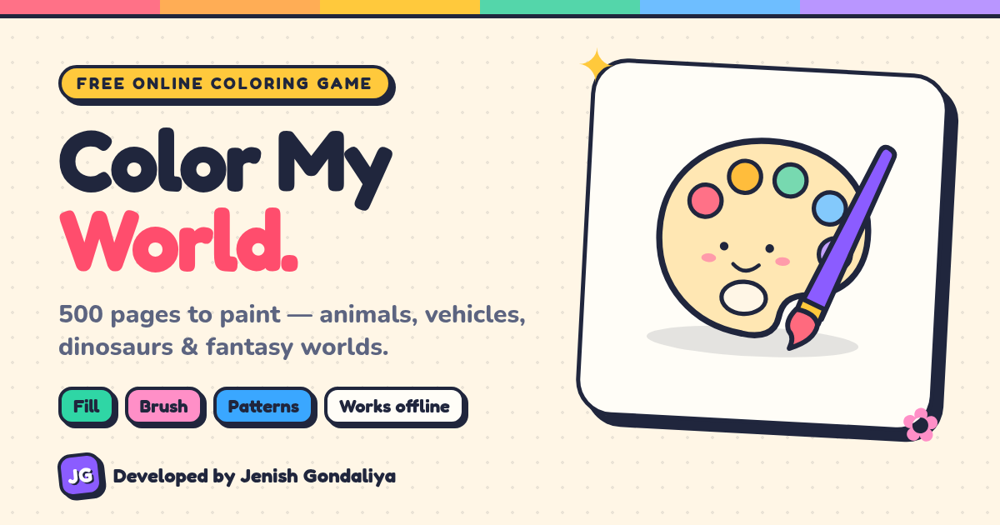
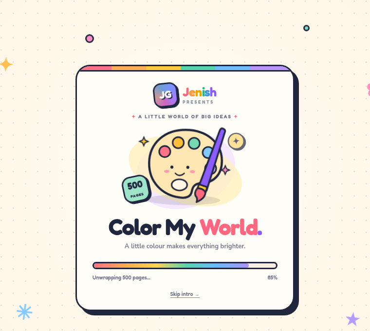
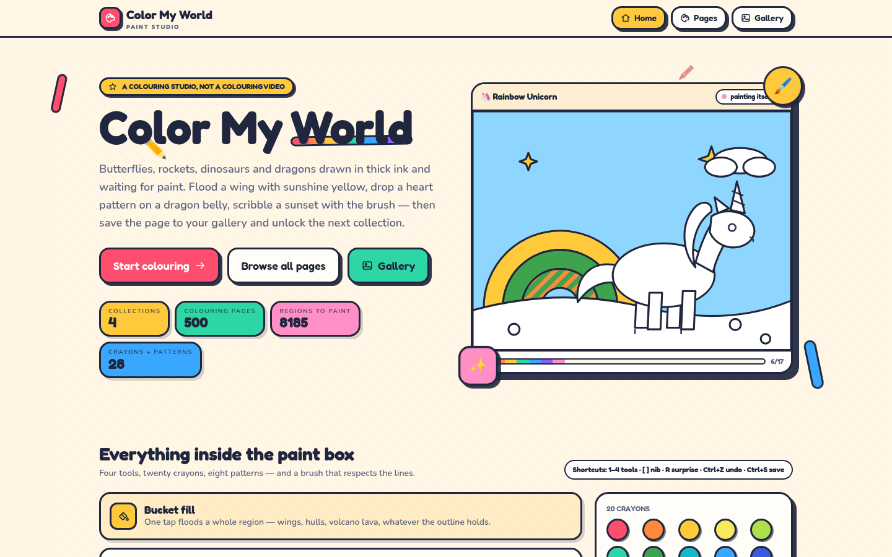
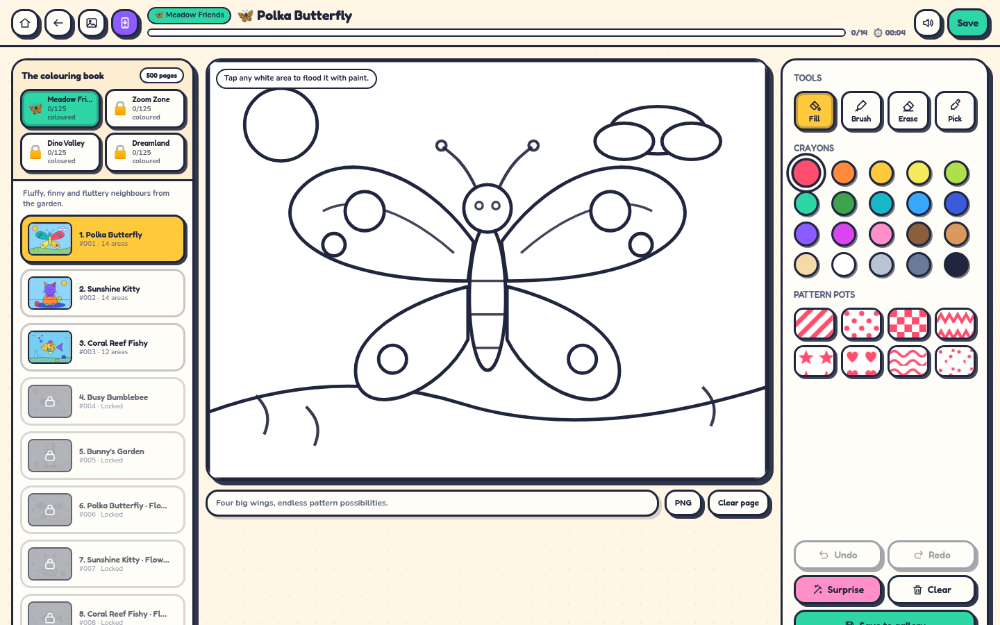
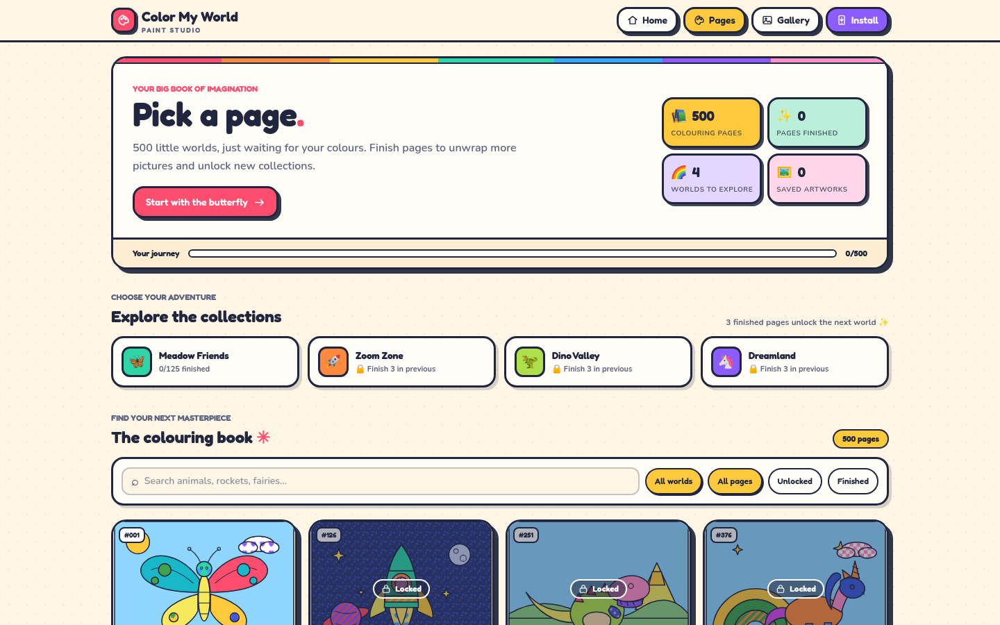

<div align="center">


# Color My World

**A free online coloring game with 500 pages to paint, which you can install and play offline.**

Animals, vehicles, dinosaurs and fantasy worlds, drawn in thick ink and waiting for colour.




</div>

---

## About

Color My World is a digital colouring book that runs in the browser. Pick a page, choose a crayon or a pattern, and tap a region to fill it. Paint never leaks past the outline. Finished pages unlock new ones, and every three finished pictures open the next collection. You can save your artwork to a personal gallery, download it as a PNG, or open it again later and keep painting.

There are no accounts and no ads. Progress and artwork stay in your browser.

## Features

- **500 colouring pages** in four collections: Meadow Friends, Zoom Zone, Dino Valley and Dreamland
- **Four tools:** bucket fill, brush (it stays inside the region you start in), eraser and colour picker
- **20 crayons and 8 pattern pots:** stripes, polka dots, checks, zig-zags, stars, hearts, waves and confetti
- **Unlocks and badges:** finish pages to open more, and earn a Champion badge at ten
- **Gallery:** name and save your artwork, re-open it, and download it as a PNG
- **Undo/redo, a Surprise fill, sound effects, confetti** and keyboard shortcuts
- **Installable PWA:** add it to your home screen or desktop and play offline
- **SEO and sharing:** Open Graph and Twitter cards, a sitemap, robots.txt and JSON-LD structured data
- **Animated splash screen** with the *Jenish JG* intro

## Screenshots

| Splash screen | Home |
| :---: | :---: |
|  |  |
| **Colouring studio** | **All pages** |
|  |  |

## How to play

1. **Pick a page.** Open **Pages** and choose any unlocked picture. Everyone starts in *Meadow Friends*.
2. **Choose a tool.** Use **Fill** to flood a region with one tap, **Brush** to scribble freely inside a region, **Erase** to clear a region, and **Pick** to copy a colour you already used.
3. **Choose a paint.** Tap one of the 20 crayons, or a pattern pot to paint stripes, dots, hearts and more.
4. **Colour every region.** The progress bar at the top shows how many regions are painted. Tap **Surprise** if you want the game to pick colours for you.
5. **Unlock more.** A finished page unlocks the next one. Three finished pictures open the next collection, and ten earn you the Champion badge.
6. **Save your work.** Press **Save**, give the picture a name, and find it in your **Gallery**. You can download it as a PNG or keep painting on it later.

### Keyboard shortcuts

| Key | Action |
| --- | --- |
| `1` `2` `3` `4` | Fill, Brush, Erase, Pick |
| `[` `]` | Make the brush nib smaller or bigger |
| `R` | Surprise fill |
| `Ctrl` + `Z` / `Ctrl` + `Shift` + `Z` | Undo / Redo |
| `Ctrl` + `S` | Save to the gallery |

## Install as an app

- **Chrome, Edge, Android:** click the purple **Install** button in the header, or use the install icon in the address bar.
- **iPhone and iPad (Safari):** tap **Install** for instructions, or tap **Share**, then **Add to Home Screen**.

After the first visit, the service worker caches the app shell and the pages you have opened, so you can keep colouring offline.

## Getting started

You need **Node.js 20.9 or newer** (Node 22 is recommended).

```bash
npm install
npm run dev        # http://localhost:3000
```

Production build:

```bash
npm run build
npm start
```

The service worker registers only in production builds (`npm run build && npm start`), so it does not get in the way of hot reload during development.

### Environment

| Variable | Purpose |
| --- | --- |
| `NEXT_PUBLIC_SITE_URL` | Public URL of the deployed site, for example `https://colormyworld.example.com`. It is used for canonical links, Open Graph image URLs, the sitemap and robots.txt. On Vercel, the production domain is used automatically if this is not set. |

### Scripts

| Command | What it does |
| --- | --- |
| `npm run dev` | Start the development server |
| `npm run build` | Create a production build |
| `npm start` | Serve the production build |
| `npm run lint` | Run ESLint |
| `npm run typecheck` | Type-check with `tsc` |

## Project structure

```
src/
├─ app/
│  ├─ layout.tsx            # Root layout, SEO metadata, JSON-LD, splash and PWA registration
│  ├─ page.tsx              # Home page
│  ├─ play/                 # Page picker and the colouring studio (/play/[sceneId])
│  ├─ gallery/              # Saved artwork
│  ├─ manifest.ts           # PWA web app manifest
│  ├─ sitemap.ts, robots.ts # SEO
│  └─ opengraph-image.png   # Thumbnail for shared links
├─ components/              # Studio, splash screen, install button, dialogs, art
└─ lib/                     # Scenes, paints, storage, audio and site config
public/
├─ sw.js                    # Service worker for offline play
└─ icons/                   # App icons (any and maskable)
```

## Tech stack

[Next.js 16](https://nextjs.org/) (App Router), [React 19](https://react.dev/), [TypeScript](https://www.typescriptlang.org/), [Tailwind CSS 4](https://tailwindcss.com/), with hand-drawn SVG line art and a hand-written service worker.

---

<div align="center">

**Developed and maintained by Jenish Gondaliya**

</div>
